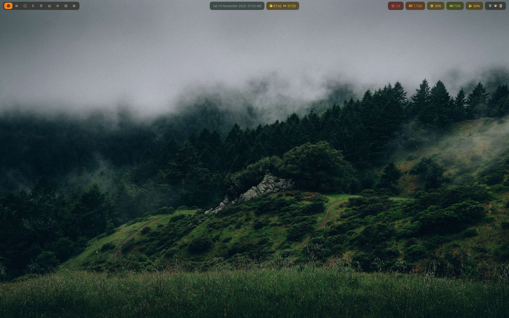
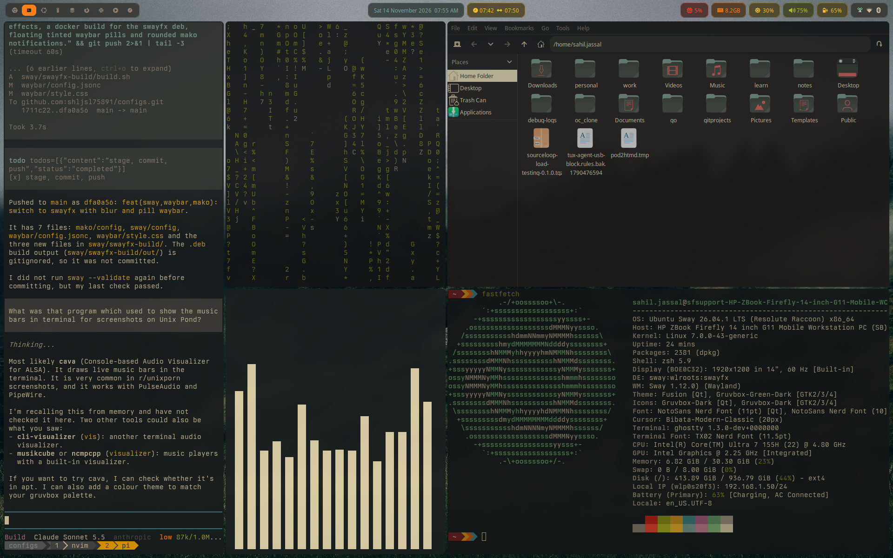

# My dotfiles

These are my configs for Ubuntu 26.04 with SwayFX. Follow the steps in order on a fresh machine.

## 1. Clone

```console
git clone --recurse-submodules https://github.com/shljsl75891/configs.git ~/personal/configs
```

The symlink commands below assume this path.

## 2. Build SwayFX and xdpw

Ubuntu has no SwayFX package, and its xdg-desktop-portal-wlr (xdpw) 0.8.1 crashed on my machine when I shared a single window (Launchpad bug 2159516). Docker builds SwayFX 0.6.1 and xdpw 0.8.2 from source into `.deb` files. Each build needs network access and takes a few minutes. The `out/` folders are git-ignored.

Run these commands from the repo root:

```console
cd ~/personal/configs
sudo apt install docker.io
sudo usermod -aG docker $USER
```

Log out and in once so the group applies. Then:

```console
sway/swayfx-build/build.sh
sway/xdpw-build/build.sh
sudo apt install ./sway/swayfx-build/out/swayfx_*.deb \
  ./sway/xdpw-build/out/xdg-desktop-portal-wlr_*.deb
```

- The SwayFX package replaces the apt `sway` package. It provides `sway`, so `waybar` and `swaybg` should stay installed.
- If `out/` holds more than one `.deb` version, name the file instead of using `*`.
- To roll back SwayFX, run `sudo apt install sway`.
- To roll back xdpw, run `sudo apt install --reinstall xdg-desktop-portal-wlr=0.8.1-1`.
- Versions are `ARG` lines at the top of each `Dockerfile`.

## 3. Install dependencies

```console
sudo apt install zsh tmux waybar mako-notifier wmenu swaylock swaybg grim slurp \
  wf-recorder wl-clipboard ffmpeg brightnessctl playerctl copyq pcmanfm \
  network-manager-gnome bluez blueman xdg-desktop-portal-gtk gnome-keyring \
  ghostty qt5ct wtype jq ncal tealdeer cmake libnotify-bin intel-media-va-driver-non-free vainfo
```

## 4. Link the configs

If a target such as `~/.config/sway` is already a real folder, move it away first, for example `mv ~/.config/sway{,.bak}`. Otherwise `ln -sfn` puts the link inside the folder.

```bash
mkdir -p ~/.config
ln -sfn ~/personal/configs/sway    ~/.config/sway
ln -sfn ~/personal/configs/waybar  ~/.config/waybar
ln -sfn ~/personal/configs/mako    ~/.config/mako
ln -sfn ~/personal/configs/qt5ct   ~/.config/qt5ct
ln -sfn ~/personal/configs/hyprvoice ~/.config/hyprvoice
ln -sfn ~/personal/configs/xdg-desktop-portal     ~/.config/xdg-desktop-portal
ln -sfn ~/personal/configs/xdg-desktop-portal-wlr ~/.config/xdg-desktop-portal-wlr

mkdir -p ~/.config/gtk-3.0 ~/.config/gtk-4.0 ~/.config/fontconfig
ln -sfn ~/personal/configs/gtk-3.0/settings.ini ~/.config/gtk-3.0/settings.ini
ln -sfn ~/personal/configs/gtk-4.0/settings.ini ~/.config/gtk-4.0/settings.ini
ln -sfn ~/personal/configs/fontconfig/fonts.conf ~/.config/fontconfig/fonts.conf
fc-cache -f

ln -sfn ~/personal/configs/mimeapps.list ~/.config/mimeapps.list

# Sway has no env directive. LightDM reads ~/.profile before it starts the session.
# Run this line once. A second run adds a duplicate.
echo '. ~/.config/sway/env' >> ~/.profile
```

The `chooser_cmd` line in `xdg-desktop-portal-wlr/config` holds an absolute path with my user name. Fix it for your user:

```bash
sed -i "s|/home/[^/]*/|$HOME/|" ~/personal/configs/xdg-desktop-portal-wlr/config
```

## 5. Start the session

At the LightDM login screen, click the session-type gear icon and select sway.

Install these yourself. `sway/config` uses them and the steps above do not:

- Brave. `$browser` is `brave-origin` (line 6). The Mod+B and Mod+Shift+B keys open `Profile 2` and `Profile 1`.
- Wallpapers. `swaybg` picks a random `*.jpg` from `~/gitprojects/wallpapers`. Put at least one image there, or edit the `swaybg` line.
- The Bibata cursor theme (`XCURSOR_THEME` in `sway/env`).
- The NotoSans Nerd Font (used by `sway/scripts/menu.sh`).
- `nvim`, OnlyOffice (`mimeapps.list`), and PipeWire (`wpctl` for the volume keys).

## Visual effects

`sway/config` has a SwayFX block: blur, rounded corners, and dimming of inactive windows. The `layer_effects` lines add blur to waybar and mako. Animations are off. To turn them on, set `animation_duration_ms 150` in `sway/config`. SwayFX 0.6.1 has no setting for only the workspace fade.

## Input

`sway/config` sets the touchpad and mouse (`input type:touchpad`, `input type:pointer`). `scroll_factor` sets the scroll speed: 1 is normal, and a higher value is faster. I use 1.0 for the touchpad and 2 for the mouse. Run `swaymsg -t get_inputs` to see device names if you need a block for one device.

## Multiple monitors

Use your own output name. `HDMI-A-1` and the position are examples.

```bash
swaymsg -t get_outputs
swaymsg output HDMI-A-1 pos 1920 0
```

The command lasts until you log out. To keep it, add the same `output` line to `sway/config`.

## Screen sharing

Window sharing in Google Meet works in Brave with xdpw 0.8.2.

- `xdg-desktop-portal/sway-portals.conf` sends screen-cast requests to xdpw. Without it, the browser can share only a tab or the whole screen.
- xdpw shows a `wmenu` list at the bottom of the screen to pick a window or monitor. `sway/scripts/menu.sh` sets the colours.
- Chromium-based browsers ask the portal twice for each share: first for a preview, then for the real stream. xdpw cannot remember a window. So `sway/scripts/xdpw-chooser.sh` repeats your last pick once within 60 seconds, and you see the menu once.

## Voice dictation (hyprvoice)

[hyprvoice](https://github.com/leonardotrapani/hyprvoice) sends your speech to Groq (whisper-large-v3-turbo). It types the text with `wtype`.

Set it up once on a fresh machine:

```bash
# 1. Install the binary
mkdir -p ~/.local/bin
wget -O ~/.local/bin/hyprvoice \
  https://github.com/leonardotrapani/hyprvoice/releases/download/v1.0.2/hyprvoice-linux-x86_64
chmod +x ~/.local/bin/hyprvoice

# 2. Install the systemd user service
mkdir -p ~/.config/systemd/user
cat > ~/.config/systemd/user/hyprvoice.service << 'EOF'
[Unit]
Description=hyprvoice voice-to-text daemon
After=graphical-session.target

[Service]
Type=simple
ExecStart=%h/.local/bin/hyprvoice serve
Restart=on-failure
RestartSec=3
PassEnvironment=XDG_RUNTIME_DIR WAYLAND_DISPLAY

StandardOutput=journal
StandardError=journal

[Install]
WantedBy=default.target
EOF

# 3. Give the service your Groq API key (console.groq.com)
mkdir -p ~/.config/systemd/user/hyprvoice.service.d
cat > ~/.config/systemd/user/hyprvoice.service.d/env.conf << 'EOF'
[Service]
Environment=GROQ_API_KEY=<your-key-here>
EOF

# 4. Enable and start
systemctl --user daemon-reload
systemctl --user enable --now hyprvoice
```

The config is `~/.config/hyprvoice/config.toml`, with `[injection] backends = ["wtype"]`. At each sway start, `sway/config` (line 11) imports `WAYLAND_DISPLAY` and `SWAYSOCK` into the systemd user manager and restarts hyprvoice. Without the import, wtype fails with "WAYLAND_DISPLAY not set".

Keys:

- `Super+d` starts recording. Press it again to stop and type the text at the cursor.
- `Super+Shift+d` cancels the recording.

## Screen capture

- `Super+s` captures a region with `grim` and `slurp`, copies it to the clipboard, and sends a notification.
- `Super+Shift+s` starts or stops a screen recording (`sway/scripts/recording.sh`). It uses `wf-recorder` with VAAPI encoding on `/dev/dri/renderD128` and saves to `~/Videos/Recordings/`. It sends a notification at start and stop.

## Default applications

Step 4 links `mimeapps.list`. Edit it to set the default app for each MIME type. For example, it opens directories in `pcmanfm` and HTML in Brave.

## pi extension tests

Some extensions in `pi/extensions/` have `*.test.ts` files. They use the Node test runner with native type stripping. They also need the installed pi release. Each extension has a `node_modules` symlink to it. See `AGENTS.md` for the fix command.

```bash
node --test pi/extensions/question-tool/*.test.ts
```

## Screenshots




